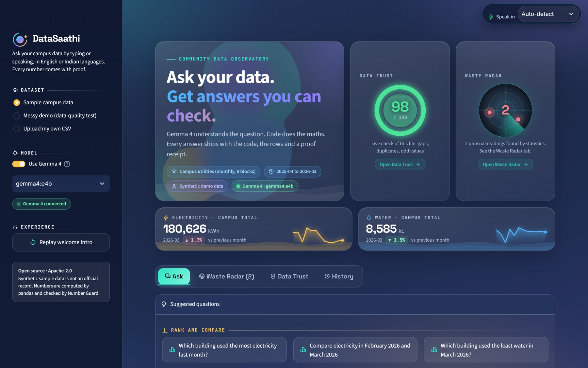
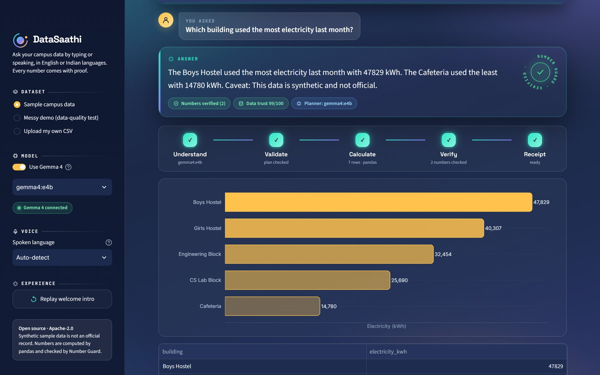
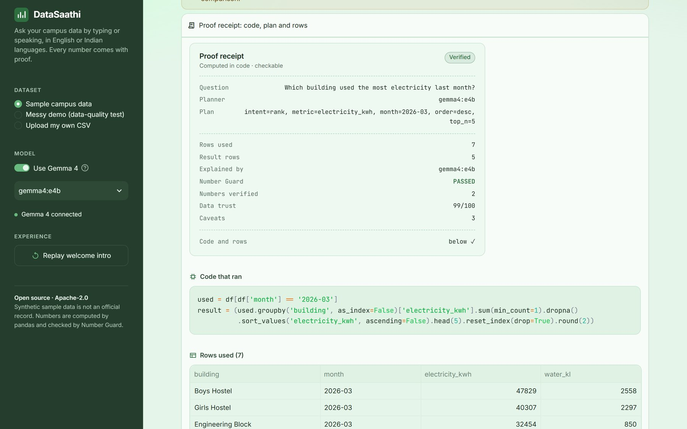
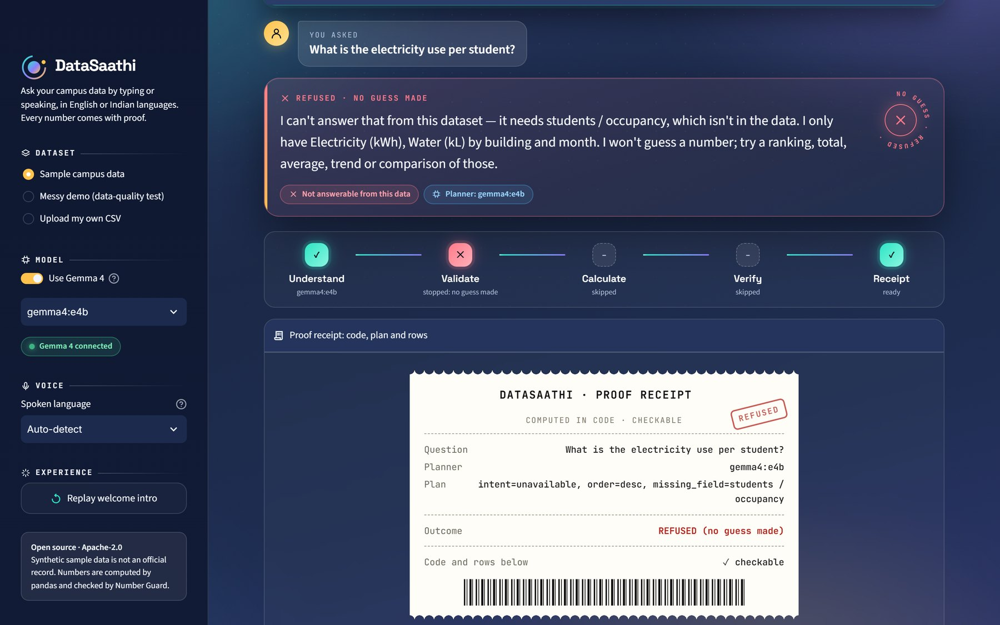
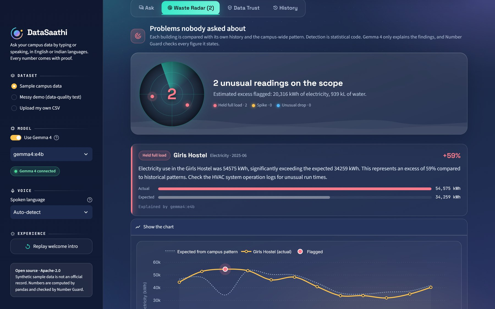
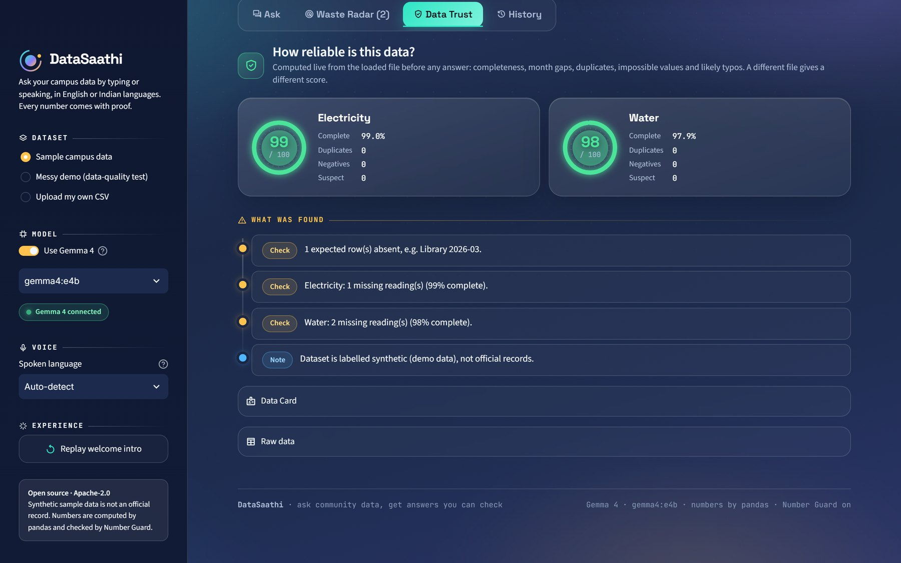
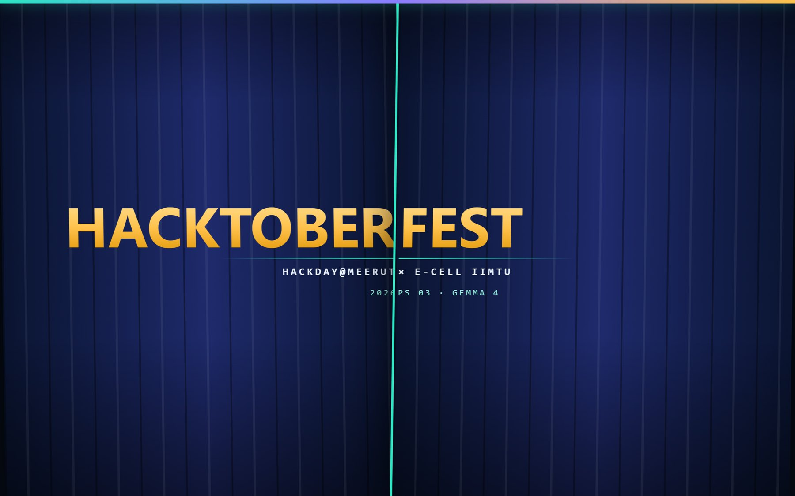
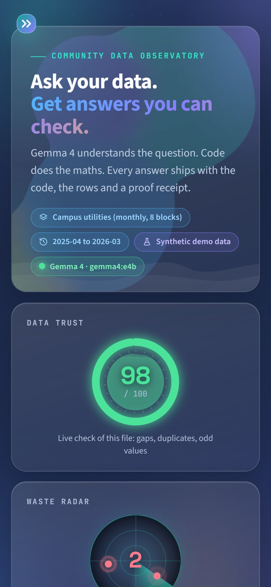

# DataSaathi

**Ask your community data in plain language. Get answers you can check.**

[](https://colab.research.google.com/github/dhruvsoran/datasaathi/blob/main/datasaathi/notebooks/DataSaathi_Colab.ipynb)


Hacktoberfest Hackday 2026 · PS 03 *Community and Environmental Data Intelligence* · Track 1 *Best Use of Gemma 4*
Built by Dhruv Soran, IIMT University, Meerut



DataSaathi lets anyone ask questions about campus electricity and water data by **typing or speaking**, in **English or nine Indian languages** (Hindi, Gujarati, Tamil, Punjabi, Marathi, Bengali, Telugu, Kannada, Malayalam).

1. **Gemma 4** turns the question into a structured analysis plan.
2. **Code (pandas) calculates every number.** The model never produces the final figure.
3. The app shows a chart, the answer, the rows used, honest caveats and a **Proof Receipt**.
4. **Number Guard** blocks any figure in the model's wording that the code did not compute.
5. **Waste Radar** finds problems nobody asked about, and the **Data Trust check** says how reliable the data is.
6. When the data cannot answer, it **refuses instead of guessing**.

**Latest update:** a redesigned interface (see [Screenshots](#screenshots)), answers in about 10 seconds instead of 2 to 3 minutes on a laptop GPU (see [Speed](#speed)), two more logged plan repairs, and a fix for uploading a CSV without a Data Card.

---

## Contents
- [Quick start](#quick-start)
- [For judges: a 5-minute tour](#for-judges-a-5-minute-tour)
- [PS 03 requirements checklist](#ps-03-requirements-checklist)
- [Languages and voice](#languages-and-voice)
- [Screenshots](#screenshots)
- [How it works](#how-it-works)
- [Choosing a Gemma 4 model](#choosing-a-gemma-4-model)
- [Speed](#speed)
- [Verify the numbers](#verify-the-numbers)
- [Bring your own data](#bring-your-own-data)
- [Troubleshooting](#troubleshooting)
- [Honest limits](#honest-limits)
- [Repository layout](#repository-layout)
- [Licence](#licence)

---

## Quick start

Pick one route. **Route A needs no installation and uses Gemma 4**, so it is the best way to see the project as intended.

### Route A: Google Colab with Gemma 4 (recommended)
1. Click the **Open in Colab** badge at the top. (The repository must be public.)
2. In Colab choose **Runtime → Change runtime type → T4 GPU**.
3. Run the cells in order. The first run downloads the model (about 9.6 GB) and takes roughly 10 to 15 minutes.
4. Cell 6 prints Gemma 4 plans and the evaluation score. Cell 7 prints a public link. Open it.
5. In the app sidebar you should see **Gemma 4 connected**.

Keep the Colab tab open while you use the app; free sessions disconnect when idle.

### Route B: your own computer
Requirements: **Python 3.11 or newer**, and [Ollama](https://ollama.com/download) for Gemma 4 (optional, see lite mode below).

**Windows (PowerShell)**
```powershell
git clone https://github.com/dhruvsoran/datasaathi.git
cd datasaathi
py -m venv .venv
Set-ExecutionPolicy -Scope Process Bypass
.venv\Scripts\Activate.ps1
pip install -r requirements.txt
```

**macOS / Linux**
```bash
git clone https://github.com/dhruvsoran/datasaathi.git
cd datasaathi
python3 -m venv .venv
source .venv/bin/activate
pip install -r requirements.txt
pip install -r requirements-voice.txt     # optional: voice questions
```

Then, on any system:
```bash
ollama pull gemma4:e4b          # about 9.6 GB; needs roughly 16 GB RAM or 10 GB VRAM. Use gemma4:e2b for 8 GB machines
python scripts/check_gemma.py   # confirms Ollama and Gemma 4 work with this app
streamlit run app.py            # opens http://localhost:8501
```

### Route C: Docker
```bash
docker compose up --build       # app + Ollama + model download; then open http://localhost:8501
```
The Docker files are provided but have not been tested end to end by the author. Routes A and B are the tested paths.

> **Lite mode.** If Ollama or Gemma 4 is not found, the app still runs with a transparent rule-based planner, and every Proof Receipt names the planner that answered. Lite mode is a safety net, not the Gemma 4 experience. To judge the Gemma 4 track, use Route A or B.

---

## For judges: a 5-minute tour

1. **Load.** The sidebar defaults to the synthetic sample data, labelled as such. The banner shows the Data Trust score and Waste Radar status.
2. **Rank.** Ask *Which building used the most electricity last month?* Open the **Proof Receipt** to see the plan, the exact code that ran and the rows used. A five-step trace shows what the backend did.
3. **Compare.** *Compare electricity use in September and October.*
4. **Unavailable statistic.** *What is the electricity use per student?* The app refuses: there is no headcount in the data.
5. **Missing observation.** *Show electricity usage for Library in March 2026.*
6. **Indian languages.** *पिछले महीने सबसे ज्यादा बिजली किस बिल्डिंग ने इस्तेमाल की?* (Hindi), or the Gujarati, Tamil and Punjabi suggestions. Or tap the green **mic** in the question bar and speak.
7. **Unasked problems.** *Is there any waste in water use?* or click the **Waste Radar** card at the top (or its tab). Girls Hostel stays near full load in the June vacation.
8. **Bad data.** Switch to *Messy demo* and watch the Data Trust score fall and answers carry warnings.
9. **New data.** Choose *Upload my own CSV* and upload `data/campus_demo_upload.csv` with `data/campus_demo_upload.card.yaml`. It has different columns and names, and a hidden water leak. Questions are in `docs/UPLOAD_DEMO_QUESTIONS.txt`.

---

## PS 03 requirements checklist

| Requirement from the brief | How it is met | Where to see it |
|---|---|---|
| Load one documented CSV with several records and clearly named columns | `data/campus_utilities.csv` (95 rows: building, month, electricity_kwh, water_kl) with a Data Card documenting columns, units, period, source and what is missing | `data/*.card.yaml`, Data Trust tab |
| Answer at least three question types (highest/lowest, trend, comparison) | Ranking, trend and period comparison, plus total, average and "unusual usage" | Ask tab |
| Calculate with code, not only a model-generated number | Every number comes from pandas. The code shown is the code that ran | Proof Receipt |
| Chart or table with a plain-language explanation, citing rows or fields | Chart, table and explanation; a line under each answer states the rows and fields used; full rows in the receipt | Ask tab |
| Warn when information is absent, a denominator is missing, or data cannot justify the conclusion | Refusals, missing-reading warnings, "no headcount or area" warning, close-ranking and tiny-change warnings, Data Trust warnings | Ask and Data Trust tabs |
| Use Gemma 4 to connect questions with evidence | Gemma 4 via Ollama plans the analysis and explains results; Number Guard verifies every figure it states | Receipt shows `Planner: gemma4:...` |
| Clearly distinguish sample or synthetic data from official records | Data Card `synthetic` flag, a visible badge, and a caveat on every answer | Banner badge, caveats |
| Demonstration checklist (ranking, comparison, unavailable statistic, visual result and calculation) | All covered in the tour above | Tour |
| Explain patterns, missing information and possible actions | Waste Radar explains findings with a suggested check; caveats explain missing information | Waste Radar tab |
| State assumptions and verify calculations in code | Assumptions and plan repairs are shown on screen and in the receipt; evaluation compares against independent pandas | Receipt, `evals/` |

**Not built (honest):** combining documents and images with structured data, and scenario comparisons. Both are on the roadmap.

---

## Languages and voice

**Typing.** Ask in English, Hindi, Gujarati, Tamil, Punjabi, Marathi, Bengali, Telugu, Kannada or Malayalam (or Hinglish). The answer comes back in the language of the question.

| | With Gemma 4 | Lite mode (no Gemma) |
|---|---|---|
| Understanding the question | Free-form wording in 140+ languages; plans are checked against the data | Keyword coverage for common phrasings in the nine Indian languages above (`datasaathi/lexicon.py`) |
| Answer language | Verified English answer is translated by Gemma 4; **Number Guard re-checks every number** and falls back to English if any changed | English |
| Warnings and notes | English | English |

**Voice (works like a WhatsApp voice note).** Tap the green **mic** in the question bar and allow the microphone. While it records, a red *Recording* label shows: tap **✓** to send or **✕** to delete. The app turns the voice note into text, asks it straight away, and shows your question as a voice-note bubble you can **replay**. A silent recording (muted mic) gets a clear message instead of an empty answer. Speech is turned into text by Whisper (`faster-whisper`), which runs on your machine or Colab GPU after a one-time model download.

```bash
pip install -r requirements-voice.txt                    # optional; the Colab notebook does this for you
DATASAATHI_STT_MODEL=small streamlit run app.py          # tiny/base for small laptops, small/medium for better Indian-language accuracy
```
Choose the language you will speak in the **Speak in** pill at the top-right corner (or leave it on Auto-detect). Microphone access works on `localhost` and `https` links (including the Colab tunnel link).

Limits, stated plainly: the keyword lists were written carefully but are not reviewed by native speakers; speech accuracy varies by language and model size; building names spoken in a non-Latin script may not match the English names in the data unless Gemma 4 maps them; and the voice path was tested with a stand-in model, not yet with real recordings.

---

## Screenshots

All captured from the running app with Gemma 4 (`gemma4:e4b`) connected, on the synthetic sample data.

| Answer: Number Guard seal, five-step trace and chart | Proof Receipt, the code that ran and the rows used |
|---|---|
|  |  |
| **Refusal: no headcount in the data, so no guess** | **Voice note: tap the mic, speak, ✓ to send, replay it** |
|  |  |
| **Waste Radar: problems nobody asked about** | **Data Trust: how reliable the file is** |
|  |  |
| **History: every question this session** | **Welcome curtain (plays once, `?intro=0` skips it)** |
|  |  |

On a phone the deck stacks into single cards:



Motion does not show in stills: the Data Trust gauge is filled with a moving liquid up to its score, gooey blobs drift behind the headline, waves roll along the panels, the radar sweeps, buttons fill with liquid on hover and answers drop in with a small bounce.

---

## How it works

```
CSV + Data Card ─► Data Trust audit
                                         ┌──────── Waste Radar (statistics in code)
question ─► Gemma 4 plan (JSON) ─► validate against Data Card ─► whitelisted pandas ─► chart + answer + caveats
                  │ unknown metric / entity / month => refusal            │
                  └──── repair step (logged) ◄─ small-model slips         ▼
                        Proof Receipt ◄─ Number Guard ◄─ Gemma 4 wording ◄┘      DuckDB query log
```

| Piece | What it does | File |
|---|---|---|
| Planner | Gemma 4 via Ollama with structured JSON output; rule-based fallback | `datasaathi/planner.py` |
| Plan validation and repair | Checks every field against the data, fixes small-model slips and logs each fix | `plan.py`, `planner.py` |
| Engine | Builds and runs the pandas code (validated values only, no builtins); produces facts and caveats | `engine.py` |
| Number Guard | Every number in model text must exist in the computed output, else a verified template answer is shown | `explain.py` |
| Waste Radar | Compares each building with its own history and the campus-wide pattern; flags unusual readings | `waste_radar.py` |
| Data Trust | Completeness, month gaps, duplicates, impossible values, likely typos, a 0 to 100 score | `data_trust.py` |
| Interface | Streamlit app: command deck, answer cards, charts, receipt, auto-scroll, voice panel | `app.py`, `ui.py`, `theme.css`, `charts.py`, `.streamlit/config.toml` |
| Languages and voice | Indian-language vocabulary, answer translation, speech to text | `lexicon.py`, `localize.py`, `voice.py` |
| Query log | Local DuckDB file and History tab | `logs.py` |

Each question replaces the previous answer on the Ask tab, so the page stays short; earlier answers are one click away in the **History** tab.

**The interface ("data observatory").** A dusk-blue canvas with soft aurora light, frosted-glass panels and instruments instead of plain numbers:
- a **command deck** at the top: Data Trust as a ring gauge, Waste Radar as a rotating scope with one blip per alert, and campus totals for the latest month with the change against the month before and a 12-month sparkline (pandas sums of the loaded file);
- every answer as a card with a rotating **Number Guard seal** (green when every figure was verified, red when the app refused), the five-step pipeline trace, a restyled chart (shaded ranking bars, a smooth trend with the peak marked) and the printed **Proof Receipt** with a VERIFIED / REFUSED stamp;
- incident cards in Waste Radar (actual against expected), ring gauges and an issue timeline in Data Trust, a question timeline in History;
- the page **scrolls itself** to the running analysis when you ask, and to the answer when it is ready;
- the **Data Trust** and **Waste Radar** cards in the deck are clickable and open their tabs;
- **voice like WhatsApp**: a green mic in the question bar; record, ✓ to send or ✕ to delete; a loader while speech becomes text; then your question shows as a voice-note bubble you can replay, and the answer follows.

On first open, a short **welcome curtain** ("HACKTOBER | FEST" written across two curtains that part to reveal the app) plays once per session and covers the whole window, sidebar included. Add `?intro=0` to the address to skip it, or press **Replay welcome intro** in the sidebar.

All motion is CSS (no JavaScript animation libraries) and is switched off automatically for visitors who ask their system for reduced motion. The redesign changed only the visual layer; the design notes are in [docs/UI_REDESIGN_PLAN.md](docs/UI_REDESIGN_PLAN.md).

---

## Choosing a Gemma 4 model

| Ollama tag | Download | Hardware | Notes |
|---|---|---|---|
| `gemma4:e2b` | about 7.2 GB | 8 GB RAM minimum | Smallest; not tested with this app |
| `gemma4:e4b` | about 9.6 GB | about 16 GB RAM or 10 GB VRAM; fits the free Colab T4 | **Default. The model we validated** |
| `gemma4:12b` | about 7.6 GB | fits the free Colab T4 | Larger dense model; not yet tested with this app |
| `gemma4:26b` | about 18 GB | 24 GB GPU (Colab L4 or A100) | Higher quality; does not fit a free T4 |
| `gemma4:31b` | about 20 GB | 24 GB GPU or more | Largest; not tested |

Choose a model in the sidebar, or run `DATASAATHI_MODEL=gemma4:12b streamlit run app.py`. Sizes come from public Ollama and community documentation and may change.

---

## Speed

Gemma 4 has a **thinking** mode that is on by default in Ollama: before every reply it writes a long hidden chain of reasoning. DataSaathi never shows or uses it (plans are JSON, and Number Guard checks every figure), so the app turns it off and keeps the model loaded:

| Setting (`datasaathi/planner.py`) | Default | What it does |
|---|---|---|
| `DATASAATHI_THINK` | `0` | `think: false` on every Gemma call. Set `1` to turn thinking back on |
| `DATASAATHI_KEEP_ALIVE` | `30m` | how long Ollama keeps the model in memory between questions (Ollama's own default is 5 minutes) |
| warm-up | on | the model is loaded in the background when the app starts, so the first question does not wait for it |

Measured on a Windows 11 laptop (RTX 3050 Laptop GPU, 4 GB; 16 GB RAM; `gemma4:e4b` through Ollama):

| | Thinking on (before) | Thinking off (now) |
|---|---|---|
| One planning call | about 35 s | about 5 s |
| One answer (plan + explanation) | 2 to 3 minutes | about 9 to 11 s |
| 20-question evaluation (`--gemma`) | not run in full (about an hour) | 181 s, **20/20** |

Without its reasoning pass the small model slips a little more often, so two more **logged repairs** were added (each one shows in the Proof Receipt and has a test in `tests/test_repair.py`): a plan that names two periods but says "anomaly" or "trend" becomes a comparison ("Which building's electricity jumped most from May to June?"), and a month with no year in the question is mapped to the one the data has ("January" means 2026-01 here, not 2025-01). Explanations are also told plainly to answer an English question in English.

---

## Verify the numbers

```bash
python evals/run_evals.py                    # 20 questions; expected answers computed with independent pandas
python evals/run_evals.py --gemma            # the same set through Gemma 4
python evals/run_evals.py --heldout --gemma  # 10 extra questions written after prompt tuning
pytest -q tests                              # Number Guard, plan repair, Data Trust, Waste Radar, query log
```

What we measured: with Gemma 4 (`gemma4:e4b` on a Colab T4) the main set first scored 11/20. After adding the validation and repair step and prompt examples it scored 20/20. The held-out set exists so you can check for overfitting; run it with `--gemma` and judge for yourself. GitHub Actions runs the offline evaluations and tests on every push.

With thinking off (laptop, see [Speed](#speed)): two runs before the new repairs scored 19/20 and 18/20; with them the main set scored **20/20** and the held-out set **9/10**. The one held-out miss ("Compare water between January and February" read as January 2025) is the case the month repair now fixes; it is covered by a unit test, but the held-out set has not been re-run through Gemma since. The rule-based planner scores 20/20, and `pytest` runs 45 tests.

---

## Bring your own data

Upload a CSV with one column of names (buildings, wards, plants), one month or date column, and one or more numeric columns. For best results add a Data Card (YAML). Example: `data/campus_utilities.card.yaml`.

```yaml
name: Campus utilities (monthly)
synthetic: true                     # set false for real records
source: Where the data came from
period: 2025-04 to 2026-03
entity_column: building
time_column: month
metrics:
  electricity_kwh: {label: Electricity, unit: kWh}
  water_kl: {label: Water, unit: kL}
not_available: [students / occupancy, cost / tariff]   # what the dataset does NOT contain
```
Data is treated as monthly. Daily readings should be summed to months first. Without a Data Card the app builds a basic one and warns that the source is not verified.

**Suggested questions follow your file** (`datasaathi/suggest.py`). They are written from the loaded data: its own name column ("Which *block* used the most electricity last month?"), its metrics, its latest months ("Compare electricity in August 2026 and September 2026"), its biggest user ("Main Academic Building electricity trend") and another of its names for an average. Questions in Hindi, Gujarati, Tamil and Punjabi appear only when the file has electricity or water columns, which those phrasings cover. Every suggestion is checked in the tests to be answerable from the file it was written for.

---

## Troubleshooting

| Problem | Fix |
|---|---|
| Sidebar says **Lite mode** | Ollama or the model was not found. Start Ollama, run `ollama pull gemma4:e4b`, refresh the page |
| `pip` or `python` not found (Windows) | Reinstall Python and tick "Add to PATH", then reopen PowerShell |
| `Activate.ps1 cannot be loaded` | Run `Set-ExecutionPolicy -Scope Process Bypass` first |
| Port 8501 is busy | `streamlit run app.py --server.port 8502` |
| Gemma 4 is very slow or runs out of memory | The app already turns off Gemma 4's hidden "thinking" pass and keeps the model loaded for 30 minutes (see [Speed](#speed)). If it is still slow, use `gemma4:e2b`, close other applications, or use Colab |
| Uploading a CSV shows an error | The file needs one column of names, one month or date column and at least one numeric column. Add a Data Card YAML to name the columns yourself |
| Colab shows no link | Re-run the last cell, or run `!tail -5 /tmp/cf.log` to see why |
| Colab says no GPU | Runtime → Change runtime type → T4 GPU, then reconnect |
| Welcome curtain is in the way | Add `?intro=0` to the address (for example `http://localhost:8501/?intro=0`), or use it once and it will not return in that session |
| Sidebar closed and gone | Click the teal **»** button at the top-left of the page to reopen it |
| No mic in the question bar, or voice says it needs the speech model | `pip install -r requirements-voice.txt`, then restart the app |
| Microphone does not record | Allow microphone access for the page; use `localhost` or an `https` link |
| Question answered "not answerable" unexpectedly | Open the Proof Receipt; the plan and `missing_field` say what the app thought was missing |

---

## Honest limits

- The sample data is **synthetic** and labelled as such. It is not an official record.
- "Sandbox" means the code is built only from validated, whitelisted values and run with no Python builtins. It is not an operating-system sandbox.
- Waste Radar thresholds are simple statistical rules tuned on the sample. Treat flags as leads to check, not proof of waste. It needs several buildings (3 or more) and at least 6 months to compare.
- Each question is independent (no follow-up memory yet), and one question maps to one plan.
- Indian-language quality depends on the Gemma 4 model you run. The rule-based fallback covers common phrasings only, and its word lists have not been reviewed by native speakers.
- Tested: Gemma 4 `e4b` on a Colab T4; lite mode on Linux with Python 3.12 (including the nine-language keyword tests); and a Windows 11 install with Python 3.11, pandas 3.1, Streamlit 1.66 and `gemma4:e4b` on a 4 GB laptop GPU. Voice was tested end to end with a synthetic spoken recording (Windows text-to-speech), not yet with many real voices. Not tested: Docker, macOS, other Gemma 4 sizes.
- Not benchmarked on large datasets. The brief asks for small ones.
- Documents and images as inputs, and scenario comparisons, are not built.

---

## Repository layout

```
app.py                     Streamlit app (tabs: Ask, Waste Radar, Data Trust, History)
datasaathi/                planner, lexicon, plan, engine, explain (Number Guard), localize, voice, waste_radar, data_trust, charts, ui, theme.css, logs
data/                      synthetic sample, messy demo, and an upload demo (CSV + Data Card each)
evals/run_evals.py         20-question set and held-out set
tests/                     unit tests
notebooks/                 Google Colab notebook (Gemma 4)
scripts/                   check_gemma.py, colab_launch.py, make_data.py
docs/                      screenshots and upload-demo questions
.streamlit/config.toml     colour theme
.github/workflows/ci.yml   evaluations and tests on every push
PITCH.md                   demo script and likely judge questions
requirements.txt, requirements-voice.txt
Dockerfile, docker-compose.yml
```

## Licence

Apache-2.0 (see `LICENSE` and `NOTICE`). Gemma 4 weights are released by Google DeepMind under Apache-2.0.
